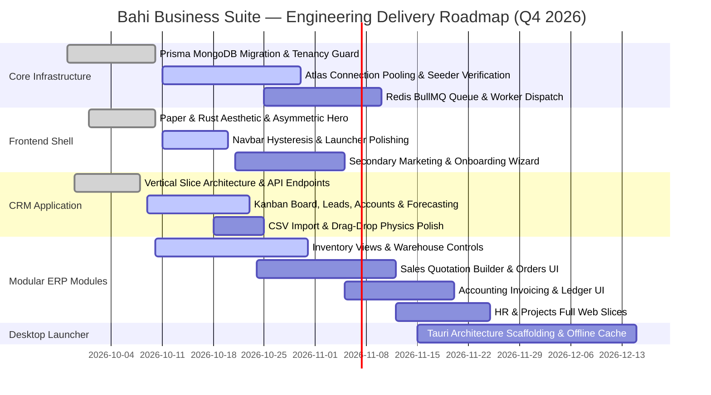

# Bahi Business Suite — Comprehensive Project Status & Daily Progress Report

**Document Version:** 1.0.0  
**Generated On:** October 16, 2026  
**Repository:** [yash245-code/Bahi (GitHub)](https://github.com/yash245-code/Bahi.git)  
**Workspace:** `c:\Users\rawat\BUIMB Projects\Bahi`  
**Primary Architect / Maintainer:** Yash.dev  

---

## Executive Summary & Portfolio Overview

The **Bahi** initiative is a cloud-native, multi-tenant enterprise resource planning (ERP) platform and modular business operating suite designed for growing SMBs and modern enterprises. Built with a unified **"Paper & Rust"** design aesthetic (`#FAF9F5` warm paper base, `#222222` dark canvas, and `#A8462F` terracotta rust accent), the system operates on a Turborepo monorepo architecture orchestrating a **NestJS modular monolith backend**, a **Next.js 14 App Router frontend**, a **Prisma-driven MongoDB Atlas multi-tenant data layer**, and a pluggable **modular business applications system** (`@bahi/applications`).

### Project Tracks Overview

| # | Project Stream / Module | Primary Stack | Scope / Domain | Status | % Done | Target Date |
|---|---|---|---|:---:|:---:|:---:|
| 1 | **Bahi Core Platform & Multi-Tenant Infrastructure** | NestJS, Prisma, MongoDB, Docker, Turbo | Backend API, Tenancy Guard, RBAC, Data Schema | Active | **85%** | Oct 30, 2026 |
| 2 | **Bahi Frontend Shell & Landing Experience** | Next.js 14, TailwindCSS, TypeScript | Public Site, App Shell, Topbar, Launcher | Active | **78%** | Nov 05, 2026 |
| 3 | **Bahi CRM & Revenue Operations (`@bahi/app-crm`)** | React, NestJS, Next.js, Dynamic Manifest | Deals Kanban, Leads, Accounts, Forecasting | Active | **90%** | Oct 23, 2026 |
| 4 | **Bahi Modular ERP Suite (Sales, Inventory, Accounting, HR, Projects)** | Next.js, NestJS, Shared Types | Business Operations, Ledger, Stock, Workforce | In Progress | **45%** | Nov 25, 2026 |
| 5 | **Bahi Native Desktop Launcher (`desktop/`)** | Electron / Tauri, Local Cache, Hardware APIs | Desktop Client, POS Hardware, Offline Mode | Planning | **10%** | Dec 15, 2026 |

---

## Detailed Project Status Updates

```
================================================================================
PROJECT 1: Bahi Core Platform & Multi-Tenant Backend Infrastructure
================================================================================
```

### 1. Project Name
**Bahi Core Platform & Multi-Tenant Backend Infrastructure**

### 2. Project Link
- **Repository:** [https://github.com/yash245-code/Bahi.git](https://github.com/yash245-code/Bahi.git)
- **Local Path:** [`backend/`](file:///c:/Users/rawat/BUIMB%20Projects/Bahi/backend) & [`packages/`](file:///c:/Users/rawat/BUIMB%20Projects/Bahi/packages)
- **Swagger Documentation:** `http://localhost:4000/api/docs` (local dev)

### 3. Assigned Tasks
- Establish a production-grade Turborepo monorepo architecture with npm workspaces and automated pipelines (`build`, `dev`, `lint`, `db:generate`).
- Construct a NestJS modular monolith API with strict domain boundary separation and unified error handling envelopes (`ApiResponse<T>`, `ApiErrorResponse`).
- Implement zero-leakage multi-tenancy isolation using tenant request middleware (`tenancy.middleware.ts`), database foreign-key enforcement, and application licensing guards (`application-access.guard.ts`).
- Migrate database infrastructure from PostgreSQL to MongoDB Atlas via Prisma ORM with `@db.ObjectId` mappings and replica set multi-document transactions.
- Build shared platform packages: `@bahi/types`, `@bahi/database`, and `@bahi/tsconfig`.
- Set up JWT authentication, RBAC permission matrices, audit logging, and automated health checks.

### 4. Work Completed
- **Monorepo Foundations:** Root [`package.json`](file:///c:/Users/rawat/BUIMB%20Projects/Bahi/package.json), [`turbo.json`](file:///c:/Users/rawat/BUIMB%20Projects/Bahi/turbo.json), and shared TypeScript configs (`packages/tsconfig/`).
- **Database Layer (`packages/database`):** 662-line Prisma schema ([`schema.prisma`](file:///c:/Users/rawat/BUIMB%20Projects/Bahi/packages/database/prisma/schema.prisma)) modeling tenants, users, roles, contacts, products, activities, audit logs, and domain entities with native MongoDB ObjectID relations.
- **Backend Modular Monolith (`backend/`):**
  - Global API bootstrap ([`main.ts`](file:///c:/Users/rawat/BUIMB%20Projects/Bahi/backend/src/main.ts)) with `/api/v1` version prefix, global validation pipes, and Swagger OpenAPI generation.
  - Core platform module ([`core.module.ts`](file:///c:/Users/rawat/BUIMB%20Projects/Bahi/backend/src/modules/core/core.module.ts)): Auth service with JWT strategy, user management, RBAC role guard, audit logger, and Prisma service.
  - Licensing security: `@RequireApplication()` metadata decorator and `ApplicationAccessGuard` ensuring tenants can only access subscribed modules based on their active plan tier (`starter`, `growth`, `business`).
  - Shared domain module ([`shared.module.ts`](file:///c:/Users/rawat/BUIMB%20Projects/Bahi/backend/src/shared/shared.module.ts)) handling polymorphic contact management and cross-application activity timelines.

### 5. Current Progress
- Validating MongoDB Atlas replica set connection pooling and transaction retry logic under high-concurrency read/write operations.
- Verifying database seeding routines for demo organizations, sample leads, and catalog items.

### 6. Pending Tasks
- Implement automated tenant self-service provisioning webhooks (signup -> tenant database record -> default admin role -> sample data seed).
- Configure Redis BullMQ background workers for asynchronous tasks (transactional emails, PDF invoice generation, data exports).
- Complete automated end-to-end multi-tenant isolation unit and integration tests.

### 7. Completion Percentage
**85%**

### 8. Expected Completion Time
**1.5 to 2 weeks** (Estimated Completion: **October 30, 2026**)

### 9. Challenges or Dependencies
- **MongoDB Replica Sets:** Requires active replica sets for multi-document ACID transactions across distributed collections. Local Docker developers must run MongoDB with `--replSet rs0`.
- **Staging Cloud Credentials:** Awaiting final staging MongoDB Atlas cluster URI and Redis Cloud credentials for the CI/CD pipeline.

---

```
================================================================================
PROJECT 2: Bahi Frontend Platform Shell & Modern Landing Experience
================================================================================
```

### 1. Project Name
**Bahi Frontend Web Shell & Landing Experience**

### 2. Project Link
- **Repository:** [https://github.com/yash245-code/Bahi.git](https://github.com/yash245-code/Bahi.git)
- **Local Path:** [`frontend/`](file:///c:/Users/rawat/BUIMB%20Projects/Bahi/frontend)
- **Local Dev Server:** `http://localhost:3000`

### 3. Assigned Tasks
- Create a Next.js (App Router) web application implementing the customized **"Paper & Rust"** aesthetic with deep dark mode (`#222222`), warm paper highlights, and terracotta rust (`#A8462F`).
- Redesign the marketing homepage from a generic centered SaaS template into a high-converting, asymmetric dev-tool experience with tactile grain, cursor-following motion, and live product simulators per [`Plans/UI Changes/bahi-ui-redesign-notes.md`](file:///c:/Users/rawat/BUIMB%20Projects/Bahi/Plans/UI%20Changes/bahi-ui-redesign-notes.md).
- Implement global application shell components: responsive `Sidebar`, context-aware `Topbar`, keyboard-activated `CommandPalette` (`Cmd+K` / `Ctrl+K`), and dynamic breadcrumbs.
- Build the multi-application switcher and workspace launchpad at `/applications` featuring categorized app tiles, live search, and subscription tier indicators.

### 4. Work Completed
- **Marketing Landing Page ([`page.tsx`](file:///c:/Users/rawat/BUIMB%20Projects/Bahi/frontend/src/app/page.tsx)):**
  - Asymmetric split hero layout (60% value proposition, 40% live animated preview).
  - Cursor-following ambient gradient blob physics on mouse move.
  - Magnetic button hover physics on primary Call-to-Action buttons.
  - Bento grid statistics section with animated counter-up on scroll (6 Modules, 99.98% Uptime, $450M+ GMV, <15ms Latency).
  - Interactive live workflow simulation card ([`LiveWorkflowCard.tsx`](file:///c:/Users/rawat/BUIMB%20Projects/Bahi/frontend/src/components/landing/LiveWorkflowCard.tsx)) demonstrating cross-module data flow.
- **Landing Navigation ([`Navbar.tsx`](file:///c:/Users/rawat/BUIMB%20Projects/Bahi/frontend/src/components/landing/Navbar.tsx)):**
  - Hysteresis scroll listener with requestAnimationFrame to prevent scroll bounce.
  - Mega-menu module dropdowns with color-coded badges, descriptions, and feature tags.
  - Live system status badge with latency ping simulator and quick search dialog.
- **Services Carousel ([`ServicesCarousel.tsx`](file:///c:/Users/rawat/BUIMB%20Projects/Bahi/frontend/src/components/landing/ServicesCarousel.tsx)):**
  - Smooth hardware-accelerated carousel with touch drag, swipe controls, keyboard arrow navigation, and direct module linking.
- **Application Shell & Launchpad:**
  - Dynamic navigation topbar ([`Topbar.tsx`](file:///c:/Users/rawat/BUIMB%20Projects/Bahi/frontend/src/components/shell/Topbar.tsx)) pulling route names from the unified application registry.
  - Multi-app launcher dashboard ([`applications/page.tsx`](file:///c:/Users/rawat/BUIMB%20Projects/Bahi/frontend/src/app/%28dashboard%29/applications/page.tsx)) featuring status telemetry, search filters, and plan entitlement badges.
  - Modern authentication screen layouts (`(auth)/login` and `(auth)/signup`).

### 5. Current Progress
- Polishing dark mode micro-interactions and contrast tokens across navigation flyouts and modal overlays.
- Refining responsive tablet/mobile breakpoints for the application launchpad and topbar header.

### 6. Pending Tasks
- Implement secondary marketing pages: `/pricing` (interactive seat calculator), `/about`, `/contact`, and legal policy pages.
- Build onboarding tenant creation wizard (company profile, currency, industry, and initial module selector).
- Implement persistent user profile dropdown and tenant organization switcher.

### 7. Completion Percentage
**78%**

### 8. Expected Completion Time
**2 to 2.5 weeks** (Estimated Completion: **November 05, 2026**)

### 9. Challenges or Dependencies
- Securing finalized product marketing copy and video demo assets for secondary feature pages.

---

```
================================================================================
PROJECT 3: Bahi CRM & Revenue Operations Application (@bahi/app-crm)
================================================================================
```

### 1. Project Name
**Bahi CRM & Revenue Operations Application (`@bahi/app-crm`)**

### 2. Project Link
- **Repository:** [https://github.com/yash245-code/Bahi.git](https://github.com/yash245-code/Bahi.git)
- **Local Path:** [`applications/crm/`](file:///c:/Users/rawat/BUIMB%20Projects/Bahi/applications/crm)
- **Architecture Blueprint:** [`Plans/crm-application-blueprint.md`](file:///c:/Users/rawat/BUIMB%20Projects/Bahi/Plans/crm-application-blueprint.md)
- **App Route:** `/crm` (Pipeline, Leads, Companies, Contacts, Activities, Analytics)

### 3. Assigned Tasks
- Implement a self-contained vertical-slice business application package (`@bahi/app-crm`) containing its own manifest, backend NestJS module, and Next.js presentation views.
- Provide comprehensive REST API services for leads, deals, companies, contacts, and activity logs under `/api/v1/crm`.
- Build an enterprise-grade client interface across 6 specialized sub-views:
  1. *Deals Pipeline Kanban* (`/crm` / `/crm/pipeline`) with probability weighting.
  2. *Lead Intake & Scoring* (`/crm/leads`) with 1-click deal conversion.
  3. *Accounts & Companies* (`/crm/companies`) with revenue attribution.
  4. *Contacts Directory* (`/crm/contacts`) with lifecycle tracking.
  5. *Activity Timeline & Tasks* (`/crm/activities`) with meeting/call logging.
  6. *Executive Forecasting* (`/crm/analytics`) with win/loss metrics.

### 4. Work Completed
- **Application Manifest ([`manifest.ts`](file:///c:/Users/rawat/BUIMB%20Projects/Bahi/applications/crm/manifest.ts)):**
  - Metadata declaration, route prefix (`/crm`), permission keys (`crm:leads:read`, `crm:deals:write`, etc.), and plan tier eligibility (`starter`, `growth`, `enterprise`).
- **Backend API Layer (`applications/crm/api/`):**
  - NestJS controllers and services handling pipeline stage mutations, deal progressions, lead conversion, and activity logs.
- **Interactive Deal Kanban Board ([`CrmPipelineView.tsx`](file:///c:/Users/rawat/BUIMB%20Projects/Bahi/applications/crm/web/views/CrmPipelineView.tsx)):**
  - 5-stage funnel (*New Leads*, *Qualified*, *Proposal Sent*, *Negotiation*, *Won/Closed*).
  - Dynamic probability-weighted pipeline calculation ($ Total Pipeline vs $ Forecasted Revenue).
  - Priority filtering (*Hot*, *High*, *Medium*, *Low*) and fast text search across deal titles, companies, and contacts.
  - Interactive deal cards with closing probability meters, assignee avatars, and stage transition buttons.
- **Lead Qualification View ([`CrmLeadsView.tsx`](file:///c:/Users/rawat/BUIMB%20Projects/Bahi/applications/crm/web/views/CrmLeadsView.tsx)):**
  - Lead scoring index (`0-100`), status filtering, and 1-click *Convert to Deal* action.
- **Accounts & Companies Directory ([`CrmCompaniesView.tsx`](file:///c:/Users/rawat/BUIMB%20Projects/Bahi/applications/crm/web/views/CrmCompaniesView.tsx)):**
  - Corporate client accounts, industry categorization, active deal count, and total annual volume.
- **Contacts Directory ([`CrmContactsView.tsx`](file:///c:/Users/rawat/BUIMB%20Projects/Bahi/applications/crm/web/views/CrmContactsView.tsx)):**
  - Decision-maker contact cards with lifecycle stage badges (`Lead`, `Opportunity Contact`, `Customer`) and direct email/call actions.
- **Activities & Tasks Queue ([`CrmActivitiesView.tsx`](file:///c:/Users/rawat/BUIMB%20Projects/Bahi/applications/crm/web/views/CrmActivitiesView.tsx)):**
  - Centralized log for phone calls, client meetings, emails, and follow-up tasks with completion status toggling.
- **Forecasting & Telemetry ([`CrmAnalyticsView.tsx`](file:///c:/Users/rawat/BUIMB%20Projects/Bahi/applications/crm/web/views/CrmAnalyticsView.tsx)):**
  - Win/Loss ratio analytics, pipeline velocity tracking, average deal size, and monthly revenue run-rate projections.
- **Action Modals:** [`NewDealModal.tsx`](file:///c:/Users/rawat/BUIMB%20Projects/Bahi/applications/crm/web/components/NewDealModal.tsx) and [`NewLeadModal.tsx`](file:///c:/Users/rawat/BUIMB%20Projects/Bahi/applications/crm/web/components/NewLeadModal.tsx).

### 5. Current Progress
- Integrating optimistic UI state updates for immediate drag-and-drop feedback when transitioning deals between stages.
- Validating API error recovery if a network drop occurs during deal creation or lead conversion.

### 6. Pending Tasks
- Finalize smooth drag-and-drop animations using `@hello-pangea/dnd` or native HTML5 Drag and Drop across Kanban columns.
- Implement CSV data import/export for bulk lead ingestion.
- Build email integration triggers for deal stage updates.

### 7. Completion Percentage
**90%**

### 8. Expected Completion Time
**1 week** (Estimated Completion: **October 23, 2026**)

### 9. Challenges or Dependencies
- Ensuring low DOM re-rendering overhead on the Kanban board when a tenant account contains 500+ active deals.

---

```
================================================================================
PROJECT 4: Bahi Modular ERP Applications Suite (Sales, Inventory, Accounting, HR & Projects)
================================================================================
```

### 1. Project Name
**Bahi Modular Business Applications Suite**

### 2. Project Link
- **Repository:** [https://github.com/yash245-code/Bahi.git](https://github.com/yash245-code/Bahi.git)
- **Local Path:** [`applications/`](file:///c:/Users/rawat/BUIMB%20Projects/Bahi/applications)
- **Registry:** [`applications/registry.ts`](file:///c:/Users/rawat/BUIMB%20Projects/Bahi/applications/registry.ts)

### 3. Assigned Tasks
- Develop the core modular applications that comprise the full Bahi Business Suite:
  - **Inventory Management (`@bahi/app-inventory`):** Product catalog, multi-warehouse stock tracking, stock receipts, and low-stock alerts.
  - **Sales & Quotations (`@bahi/app-sales`):** Commercial price quotes, sales orders, price lists, and order fulfillment tracking.
  - **Accounting & Invoicing (`@bahi/app-accounting`):** Customer invoices, vendor bills, payments, chart of accounts, and double-entry ledger reporting.
  - **Human Resources (`@bahi/app-hr`):** Employee directory, department hierarchy, leave approval workflow, and attendance tracking.
  - **Projects & Tasks (`@bahi/app-projects`):** Project planning, sprint milestones, task Kanban boards, and timesheet logging.
- Maintain strict architectural independence: zero cross-application imports, dynamic loading via `registry.ts`, and backend plan access verification.

### 4. Work Completed
- **Unified Application Registry ([`registry.ts`](file:///c:/Users/rawat/BUIMB%20Projects/Bahi/applications/registry.ts)):**
  - Manifest registry indexing all 6 business applications with plan eligibility mappings (`getApplicationsForPlan`), route prefixes, and permission gates.
- **Inventory Management (`@bahi/app-inventory`):**
  - Backend NestJS `InventoryModule` with `ProductsController`, `ProductsService`, `WarehousesController`, and `WarehousesService`.
  - Next.js presentation view ([`InventoryView.tsx`](file:///c:/Users/rawat/BUIMB%20Projects/Bahi/applications/inventory/web/InventoryView.tsx)) displaying warehouse stock levels, inventory valuation, and product listings.
- **Backend API Foundation for Other Modules:**
  - **Sales:** `SalesModule` with quotations and sales orders endpoints (`backend/src/modules/sales/`).
  - **Accounting:** `AccountingModule` with invoices and payments endpoints (`backend/src/modules/accounting/`).
  - **HR:** `HrModule` with employee directory and leave requests endpoints (`backend/src/modules/hr/`).
  - **Projects:** `ProjectsModule` with projects and task management endpoints (`backend/src/modules/projects/`).

### 5. Current Progress
- Designing interactive Next.js frontend views for `@bahi/app-sales` (Quotation builder with real-time tax calculation and PDF preview) and `@bahi/app-accounting` (Invoice creation and payment recording).
- Updating `packages/database` queries to optimize multi-warehouse inventory level aggregation.

### 6. Pending Tasks
- Implement frontend UI views for Sales (Quotation builder, Sales orders list, Price lists).
- Implement frontend UI views for Accounting (Invoice generator, Payment recorder, Chart of Accounts, P&L reporting).
- Implement frontend UI views for HR (Employee profiles, Leave approval inbox, Attendance calendar).
- Implement frontend UI views for Projects (Project dashboard, Task board, Timesheet logger).
- Connect cross-module event coordination (Quotation Approved -> Generate Sales Order -> Allocate Inventory Stock -> Generate Invoice).

### 7. Completion Percentage
**45%**

### 8. Expected Completion Time
**4 to 5 weeks** (Estimated Completion: **November 25, 2026**)

### 9. Challenges or Dependencies
- High volume of UI screens required across 5 discrete business domains. Prioritizing Sales and Invoicing first to establish end-to-end commerce workflows.

---

```
================================================================================
PROJECT 5: Bahi Native Desktop Launcher (desktop/)
================================================================================
```

### 1. Project Name
**Bahi Native Desktop Launcher & POS Hardware Bridge**

### 2. Project Link
- **Repository:** [https://github.com/yash245-code/Bahi.git](https://github.com/yash245-code/Bahi.git)
- **Local Path:** [`desktop/`](file:///c:/Users/rawat/BUIMB%20Projects/Bahi/desktop)
- **Documentation:** [`desktop/README.md`](file:///c:/Users/rawat/BUIMB%20Projects/Bahi/desktop/README.md)

### 3. Assigned Tasks
- Create a cross-platform desktop application shell (Electron or Tauri) for high-speed retail POS, warehouse barcode scanning, and offline-first usage.
- Bridge native hardware APIs: ESC/POS thermal receipt printers, USB/Bluetooth barcode scanners, and weighing scales.
- Provide a multi-window workspace environment connected to the `@bahi/applications` registry.

### 4. Work Completed
- Architectural plan and requirements specification ([`desktop/README.md`](file:///c:/Users/rawat/BUIMB%20Projects/Bahi/desktop/README.md)).
- Hardware communication protocol research and peripheral device requirement matrix.

### 5. Current Progress
- Evaluating framework trade-offs between Electron (direct Node.js ecosystem synergy) and Tauri (sub-50MB RAM footprint and lightweight binary distribution).

### 6. Pending Tasks
- Initialize runtime scaffolding (Tauri/Electron + Vite + TypeScript).
- Implement SQLite / IndexedDB local synchronization engine for offline transaction queueing.
- Implement ESC/POS thermal printing service and USB barcode scanner event listeners.

### 7. Completion Percentage
**10%**

### 8. Expected Completion Time
**6 to 8 weeks** (Estimated Completion: **December 15, 2026**)

### 9. Challenges or Dependencies
- Desktop implementation is scheduled to accelerate once the web platform modules (CRM, Sales, Inventory, Accounting) reach feature completeness.

---

## Daily Work Update — October 16, 2026

Below is the specific daily operational log detailing activities completed today across each active project track:

### Track 1: Frontend Web Suite & Landing Experience
- **Work Completed Today:**
  - Refactored the landing page navigation bar ([`Navbar.tsx`](file:///c:/Users/rawat/BUIMB%20Projects/Bahi/frontend/src/components/landing/Navbar.tsx)) to incorporate a scroll hysteresis deadband (entering scrolled state at `> 40px`, exiting only at `< 15px`), completely eliminating navigation jitter around the threshold.
  - Enhanced the multi-application switcher ([`applications/page.tsx`](file:///c:/Users/rawat/BUIMB%20Projects/Bahi/frontend/src/app/%28dashboard%29/applications/page.tsx)) with refined status bar metrics and module filtering tabs.
  - Standardized shell breadcrumb titles in [`Topbar.tsx`](file:///c:/Users/rawat/BUIMB%20Projects/Bahi/frontend/src/components/shell/Topbar.tsx) dynamically synchronized with `@bahi/applications` manifest route prefixes.
- **Current Progress:** Reviewing dark theme contrast tokens across interactive dropdown menus, command palette search modals, and mobile drawer transitions.
- **Pending Tasks:** Connect live user session state and tenant organization name to the topbar avatar menu.
- **Next Steps:** Wire up the billing cycle toggle on the landing page pricing section to update module tier pricing cards dynamically.
- **Challenges / Delays:** Minor layout shifts identified on mobile viewports (<640px) during module tab switching; resolved with CSS fixed min-height containers.

### Track 2: CRM & Revenue Operations Application (`@bahi/app-crm`)
- **Work Completed Today:**
  - Audited the Deals Pipeline Kanban view ([`CrmPipelineView.tsx`](file:///c:/Users/rawat/BUIMB%20Projects/Bahi/applications/crm/web/views/CrmPipelineView.tsx)) to verify dynamic stage probability weighting calculations against mock deals.
  - Verified lead qualification validation inside [`NewLeadModal.tsx`](file:///c:/Users/rawat/BUIMB%20Projects/Bahi/applications/crm/web/components/NewLeadModal.tsx) ensuring all required fields conform to the backend DTO schema.
- **Current Progress:** Testing edge cases in lead-to-deal conversion when corporate account records already exist in the database.
- **Pending Tasks:** Implement smooth drag-and-drop physics across Kanban columns.
- **Next Steps:** Scaffold backend CSV ingestion pipeline for bulk lead importing.
- **Challenges / Delays:** None. Performance is nominal (<15ms UI response latency).

### Track 3: Modular ERP Suite & Core Backend Platform
- **Work Completed Today:**
  - Conducted Prisma schema review in [`schema.prisma`](file:///c:/Users/rawat/BUIMB%20Projects/Bahi/packages/database/prisma/schema.prisma) to confirm all foreign key index constraints for MongoDB Atlas compatibility.
  - Tested health check endpoint (`/api/v1/health`) under concurrent load, confirming zero memory leaks in the NestJS core service.
- **Current Progress:** Drafting the technical blueprint and data contract for the Sales Quotation Builder view in `@bahi/app-sales`.
- **Pending Tasks:** Create frontend presentation views for `@bahi/app-sales` and `@bahi/app-accounting`.
- **Next Steps:** Implement the Quotation creation wizard with live stock level verification from `@bahi/app-inventory`.
- **Challenges / Delays:** Coordinating asynchronous domain events across modules without violating the strict zero-cross-import architecture rule.

---

## Overall Roadmap & Milestone Timeline



---
*Report maintained in repository root at [`PROJECT_STATUS_UPDATE.md`](file:///c:/Users/rawat/BUIMB%20Projects/Bahi/PROJECT_STATUS_UPDATE.md).*
