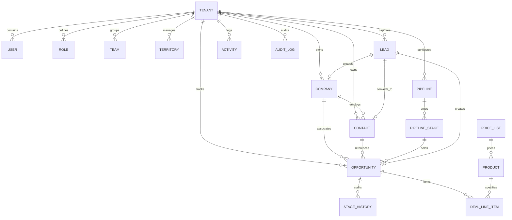

# BAHI CRM: Master Architecture & Technical Specification

## 1. Executive Summary & Design Principles

Bahi CRM is an enterprise-grade, multi-tenant CRM built as an Odoo-style modular suite component that can operate standalone or as an integrated revenue engine alongside Sales, Invoicing, Inventory, HR, and Projects.

### Core Architectural Decisions
1. **Multi-Tenancy at the Data Layer**:
   - Shared PostgreSQL database with shared schema.
   - Every single multi-tenant table includes `tenant_id` (UUID).
   - Enforced by PostgreSQL Row-Level Security (RLS) via `app.current_tenant_id` session setting.
   - Guarded in application code via a custom Prisma Client extension that automatically injects `tenantId` into `where` and `data` objects, preventing cross-tenant data leaks even if an engineer omits a filter.
   - Normalized soft-delete pattern (`deleted_at TIMESTAMP WITH TIME ZONE NULL`) on all primary business records, with restore capabilities from Trash.
   - Every record tracks `created_by`, `updated_by`, `created_at`, `updated_at`.

2. **Decoupled Vertical Slice (`applications/crm`)**:
   - `manifest.ts`: Self-describing application metadata, permissions, feature flags, navigation routes, and extension hooks.
   - `api/`: NestJS controllers, services, DTOs, domain event emitters, automation handlers, and worker tasks.
   - `web/`: Modern React presentation layer utilizing TanStack Query for cache invalidation & optimistic updates, TanStack Table with virtualization for large record sets, `dnd-kit` for Kanban physics, and React Hook Form + Zod for strict client validation.

3. **Performance & Calm Ergonomics**:
   - Zero gratuitous animations; 100-150ms subtle focus/hover transitions respecting `prefers-reduced-motion`.
   - Neutral palette with Terracotta accent (`#A8462F`), accessible contrast (WCAG AA), full keyboard navigation (`Ctrl/Cmd+K` global command palette).
   - Side drawers for zero-context-loss inspection, modals restricted to destructive confirmations and high-focus intake forms.

4. **Extensibility & Configuration Without Code**:
   - Tenant-definable custom fields (text, number, currency, select, multi-select, date, user lookup, formula) stored in structured `JSONB` with typed metadata.
   - Multiple configurable pipelines with custom ordered stages, rotting thresholds, required stage-gate fields, and win/loss probability defaults.
   - Dynamic saved views with nested AND/OR query criteria, column persistence, and team sharing.
   - Visual event-driven automation engine (`trigger -> condition_tree -> action_list`).

---

## 2. Domain Model & Entity Relationships



---

## 3. Directory Layout & Module Structure

```
applications/crm/
├── manifest.ts                    # Application manifest, navigation, permissions
├── package.json                   # @bahi/app-crm package definition
├── api/                           # Backend NestJS implementation
│   ├── crm.module.ts              # Root CRM NestJS module
│   ├── index.ts                   # Export surface
│   ├── common/                    # CRM-specific guards, interceptors, decorators
│   ├── leads/                     # Leads controller, service, DTOs, conversion
│   ├── contacts/                  # Contacts controller, service, DTOs
│   ├── companies/                 # Companies/Accounts controller, service, DTOs
│   ├── opportunities/             # Deals, Kanban stage transition, stage gates
│   ├── pipelines/                 # Pipeline & Stage management, rotting calculation
│   ├── activities/                # Tasks, meetings, calls, notes, unified queue
│   ├── custom-fields/             # Tenant custom field definitions & validations
│   ├── views/                     # Saved views, filter definitions, column preferences
│   ├── automations/               # Automation rules runner, triggers & actions
│   ├── sequences/                 # Multi-step outreach sequences
│   ├── products/                  # Catalog, price lists, deal line items
│   ├── quotes/                    # Quotation draft builder & Sales handoff
│   ├── duplicates/                # Fuzzy match engine & merge wizard
│   ├── imports-exports/           # CSV/Excel processor & background jobs
│   ├── reports/                   # Win-loss, forecasting, sales velocity metrics
│   └── webhooks/                  # Inbound lead webhooks (Meta, Google, IndiaMART)
└── web/                           # Next.js Presentation Components
    ├── index.ts                   # Export surface
    ├── components/                # Reusable CRM UI components (Nav, Modals, Drawers)
    ├── hooks/                     # TanStack Query & mutation hooks
    └── views/                     # Core CRM View screens
        ├── CrmDashboardView.tsx   # Executive & sales rep telemetry dashboard
        ├── CrmPipelineView.tsx    # dnd-kit multi-pipeline Kanban board
        ├── CrmLeadsView.tsx       # Intake queue, scoring, 1-click conversion
        ├── CrmCompaniesView.tsx   # Corporate accounts, hierarchy & rollups
        ├── CrmContactsView.tsx    # Stakeholder directory & 360 customer profile
        ├── CrmActivitiesView.tsx  # Unified tasks, calls, meetings queue
        ├── CrmCalendarView.tsx    # Calendar schedules & meeting bookings
        ├── CrmQuotesView.tsx      # Deal quote builder & handoff
        ├── CrmReportsView.tsx     # Forecasting, pipeline velocity & win-loss
        └── CrmSettingsView.tsx    # Pipelines, stages, custom fields, automations
```
